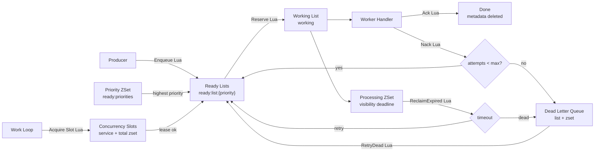

# redisqueue

[](https://github.com/xiaojiecode/redisqueue/actions/workflows/test.yml)

版本：v0.2.0

`redisqueue` 是 Go Redis 任务队列组件，适合轻量异步任务、后台补偿任务和需要优先级控制的内部任务流。

需要 Go 1.26 或更新版本，客户端使用 go-redis/v9。安装：

```sh
go get github.com/xiaojiecode/redisqueue@v0.2.0
```

导入 `github.com/xiaojiecode/redisqueue`，Redis 客户端由调用方创建和关闭。完整可编译示例见 `example_test.go`。

## 设计目标

- 用 Redis list + zset 模拟任务队列、工作队列和死信队列。
- 支持高优先级先消费，同优先级 FIFO。
- 用 Lua 脚本封装关键状态转换，避免多命令竞态导致消息丢失。
- worker 崩溃、ACK 失败或进程退出时，任务可通过可见性超时回收。
- 暴露统计、DLQ 查询、DLQ 重试、手动 ACK/NACK 和自动 Work 循环。
- 消费者并发量由 `Work` 循环统一控制，支持本进程并发、服务级分布式并发和队列总分布式并发。
- worker、并发槽续租和统计协程统一经过安全协程入口，panic 会记录堆栈；分布式槽位释放失败会显式记录。

## 架构图



## 数据结构

- ready queue：每个优先级一个 Redis list，同优先级 FIFO。
- priority index：zset 记录非空优先级桶，score 使用负优先级，高优先级先消费。
- working queue：list 记录已领取、未确认的任务 ID。
- processing index：zset 记录 working 任务的可见性超时时间。
- dead-letter queue：list + zset 保存死信任务和进入死信时间。
- metadata：hash 保存 payload、priority、attempts、enqueue/update/dead 时间和死信原因。

关键状态转换均由 Lua 脚本完成，避免 ready -> working、ACK、NACK、超时回收中的多命令竞态。

## Key 设计

所有 Key 默认以 `redisqueue:{Name}:` 开头，`{Name}` 是 Redis hash tag，便于同一队列在 Redis Cluster 中落到同一个 slot。

| Key 后缀 | 类型 | 说明 |
| --- | --- | --- |
| `ready:priorities` | zset | 非空优先级桶索引，score 为负优先级 |
| `ready:list:{priority}` | list | 指定优先级的 ready 任务 ID，FIFO |
| `working` | list | 已领取但未 ACK/NACK 的任务 ID |
| `processing` | zset | working 任务的可见性超时截止时间 |
| `dead` | list | 死信任务 ID |
| `dead:index` | zset | 死信任务进入 DLQ 的时间 |
| `data` | hash | 任务 payload |
| `priority` | hash | 任务优先级 |
| `attempts` | hash | 已领取尝试次数 |
| `enqueued` / `updated` / `dead:*` | hash | 时间和死信原因元数据 |

## 快速使用

```go
client := redis.NewClient(&redis.Options{Addr: "127.0.0.1:6379"})

queue := redisqueue.MustNew(client, redisqueue.Config{
	Name:              "report-jobs",
	VisibilityTimeout: 2 * time.Minute,
	MaxAttempts:       3,
	ReclaimBatchSize:  100,
	EnableLog:         true,
})

_, err := queue.Enqueue(ctx, redisqueue.EnqueueRequest{
	ID:       "task-123",
	Payload:  []byte(`{"resource_id":"r_001"}`),
	Priority: 10,
})
```

## Payload 字节与序列化

`EnqueueRequest.Payload`、`Task.Payload` 和 `TaskInspect.Payload` 均为 `[]byte`。队列原样保存和返回消息字节，不解析内容，也不自动执行 JSON 编码或解码。调用方可使用 JSON、Protobuf 或压缩格式。

```go
payload, err := json.Marshal(event)
if err != nil {
    return err
}
_, err = queue.Enqueue(ctx, redisqueue.EnqueueRequest{ID: "task-123", Payload: payload})
```

消费者直接使用 `json.Unmarshal(task.Payload, &event)`，无需先做字符串转换。

### 内存与空值

- `Enqueue` 复制输入字节，返回的 `Task.Payload` 不与调用方输入共享可写内存。调用结束后可以复用输入缓冲区；调用期间不得并发修改它。
- 查询或领取结果属于调用方，修改返回的字节不会改写 Redis 中的消息。
- `nil` 和 `[]byte{}` 都是有效的空消息，Redis 会保存一个存在但长度为零的字段。入队、领取、死信读取以及包含正文的任务检查均把已存在的空消息返回为非 nil 的空切片。
- `InspectTask(..., false)` 或任务正文不存在时，`Payload` 为 nil。判断正文是否存在使用 `HasPayload`，不要根据字节长度判断。

### JSON 表示与 v0.2.0 升级

直接用标准库 `encoding/json` 序列化 `Task` 或 `TaskInspect` 时，非空 `Payload` 会编码为 Base64 字符串，例如 `[]byte("hello")` 表示为 `"aGVsbG8="`。这只是结构体的 JSON 表示；Redis 中存储的仍是原始字节。

`Task.Payload` 的空切片编码为 `""`，手动构造的 nil 字段编码为 `null`。`TaskInspect.Payload` 带有 `omitempty`，nil 和空切片都会省略，仍可通过 `has_payload` 判断正文是否存在。

v0.2.0 是 Go API 的不兼容变更：原先的字符串输入改为 `[]byte(text)`，文本展示按需要使用 `string(task.Payload)`，内容比较使用 `bytes.Equal`。直接将任务结构体作为 HTTP JSON 响应的调用方也需要适配 Base64 表示。

Redis Key 和保存的消息字节格式保持一致，v0.1.1 已有队列数据不需要迁移，Receipt 和 ACK/NACK 行为保持不变。此版本不增加通用序列化接口或自定义 JSON 编码。

## Worker 消费

```go
err := queue.Work(ctx, func(ctx context.Context, task *redisqueue.Task) error {
	// task.Payload 由业务自行反序列化。
	// 返回 nil：ACK 并删除任务元数据。
	// 返回 error：NACK，未超过 MaxAttempts 时重试，否则进入 DLQ。
	return handleTask(ctx, task.Payload)
}, redisqueue.WorkerConfig{
	ServiceName:              "report-worker",
	Concurrency:              4,
	ServiceConcurrency:       20,
	TotalConcurrency:         80,
	ConcurrencyLeaseTTL:      2 * time.Minute,
	ConcurrencyRenewInterval: 30 * time.Second,
	StatsLogInterval:         time.Minute,
	SpinMinInterval:          20 * time.Millisecond,
	SpinMaxInterval:          time.Second,
	SpinFactor:               2,
	ReclaimInterval:          30 * time.Second,
	ReclaimBatch:             100,
})
```

## 手动控制

```go
task, _ := queue.Reserve(ctx)
if task != nil {
	if err := handleTask(ctx, task.Payload); err != nil {
		_, _ = queue.Nack(ctx, task.ID, task.Receipt, err.Error(), true)
	} else {
		_, _ = queue.Ack(ctx, task.ID, task.Receipt)
	}
}

_, _ = queue.ReclaimExpired(ctx, 100)
deadTasks, _ := queue.DeadLetters(ctx, 100)
stats, _ := queue.Stats(ctx)
concStats, _ := queue.ConcurrencyStats(ctx, "report-worker")

stopStats := queue.StartStatsReporter(ctx, time.Minute, "report-worker")
defer stopStats()

inspect, _ := queue.InspectTask(ctx, "task-123", false)
```

## 统计字段

`Stats` 不读取 payload，只返回队列长度：

- `Ready`：ready list 中的任务总数。
- `PriorityBucket`：当前非空优先级桶数量。
- `Working`：working list 长度。
- `Processing`：processing zset 长度。
- `Dead`：DLQ list 长度。
- `DeadIndex`：DLQ zset 长度。
- `TotalPayload`：仍保留 payload 的任务总数。

`ConcurrencyStats(ctx, serviceName)` 返回分布式并发槽位：

- `Total`：当前队列所有服务已占用的总并发槽位。
- `Service`：指定服务已占用的并发槽位。

`InspectTask(ctx, id, includePayload)` 按任务 ID 查询单条消息运行状况：

- `Status`：`ready`、`working`、`dead`、`done` 或 `orphan`。
- `Exists`：是否仍有元数据或队列索引。
- `HasPayload`：payload 是否仍保留。
- `Priority`、`Attempts`、`EnqueuedAt`、`UpdatedAt`：基础元数据。
- `DeadlineAt`：working 状态的可见性超时截止时间。
- `DeadAt`、`Reason`：DLQ 状态的死信时间和原因。
- `ReadyPosition`：ready list 中的位置，0 表示队首。

默认建议 `includePayload=false`，避免在排查日志或接口响应里泄漏任务内容。

## 周期统计日志

`Work` 会在 `StatsLogInterval > 0` 时自动周期打印统计：

```text
[RedisQueue:report-jobs] stats ready=10 priorityBucket=2 working=4 processing=4 dead=1 deadIndex=1 totalPayload=15
[RedisQueue:report-jobs] concurrency service=report-worker total=4 serviceSlots=4
```

如果没有启动 `Work`，也可以手动调用：

```go
stopStats := queue.StartStatsReporter(ctx, time.Minute, "report-worker", "export-worker")
defer stopStats()
```

## 并发控制

`Work` 内部先取得并发槽位，再领取任务：

- `Concurrency`：当前进程内最多同时处理多少个任务。
- `ServiceName` + `ServiceConcurrency`：同一服务在所有实例中的总并发上限。不同服务可以配置不同值。
- `TotalConcurrency`：同一队列在所有服务中的总并发上限。
- `ConcurrencyLeaseTTL`：分布式并发槽位租约。进程异常退出后，槽位会在 TTL 后自动过期。
- `ConcurrencyRenewInterval`：长任务处理期间自动续租间隔，应小于 `ConcurrencyLeaseTTL`。

示例：A 服务配置 `ServiceConcurrency=10`，B 服务配置 `ServiceConcurrency=30`，同时二者都配置 `TotalConcurrency=35`。此时 A 最多 10 个，B 最多 30 个，但 A+B 总数不会超过 35 个。

## 参数建议

- `VisibilityTimeout` 应大于任务正常处理耗时的 P99，避免任务仍在执行时被回收。
- `MaxAttempts` 建议从 3 开始，外部依赖不稳定的任务可适当调高。
- `Concurrency` 控制单进程本地并发；`ServiceConcurrency` 控制同服务所有实例总并发；`TotalConcurrency` 控制同队列所有服务总并发。
- `ConcurrencyLeaseTTL` 建议不小于 `VisibilityTimeout`，`ConcurrencyRenewInterval` 建议为租约的 1/3 左右。
- `StatsLogInterval` 控制周期统计日志间隔；0 表示不打印，建议生产环境从 1 分钟开始。
- `SpinMinInterval` 和 `SpinMaxInterval` 控制空队列自旋退避，低延迟场景调小，高吞吐后台任务调大。
- 日志只记录队列名、任务 ID、优先级、尝试次数等定位信息，不要把敏感 payload 写入日志。

## 投递与恢复边界

- 任务领取会原子移动到 working，并写入 processing 超时索引。
- worker 崩溃或 ACK 失败时，任务仍保留在 working/processing 中，后续 `ReclaimExpired` 会回收。
- 超过最大尝试次数的任务进入 DLQ，保留 payload 和失败原因，支持 `RetryDead` 重新投递。

## 测试与边界覆盖

- 并发安全：并发 `Reserve` 不重复领取，并发 `Ack` 同一任务只有一次成功。
- 分布式并发：覆盖服务级/总量级并发限制、租约过期释放和续租保持。
- 任务状态：覆盖 ready、working、dead、done、orphan 和 ready position。
- 失败路径：覆盖空任务 ID、缺失任务、NACK 直接 DLQ、超时回收批量限制。
- 验证命令：`go test -count=1 ./...` 和 `go test -race -count=1 ./...`。

## 领取凭证与接口

每次 `Reserve` 都会返回新的随机 `Task.Receipt`，对应 Redis 的 `receipts` hash。必须把本次领取的凭证原样交给确认接口：

```go
ok, err := queue.Ack(ctx, task.ID, task.Receipt)
result, err := queue.Nack(ctx, task.ID, task.Receipt, "处理失败", true)
```

- 空 ID 返回 `ErrEmptyTaskID`，空凭证返回 `ErrEmptyReceipt`。
- 当前存在其他领取凭证时，返回 `ErrStaleReceipt`，不会修改数据。
- 没有有效领取凭证时，ACK 返回 `false, nil`；NACK 返回 `Action="not_found"`。
- 正常 ACK、NACK 和超时回收会删除本次凭证。重新领取、死信重投及已完成 ID 再次入队后，旧凭证都无法确认新任务。
- 到达可见性截止时间并不会自动执行回收。Receipt 在 ACK/NACK 或 `ReclaimExpired` 实际撤销前仍有效。
- Receipt 只出现在领取结果中，检查和统计接口不返回它。业务日志应避免直接打印包含凭证和 payload 的整个 Task。

## 使用限制

- 投递可能重复，业务处理必须幂等。Receipt 保护队列状态，不能撤销已经发生的外部副作用。
- 可见性超时不会自动续期；并发槽续租只续槽位，不续任务的可见性期限。长任务需配置足够大的 `VisibilityTimeout`。
- 处理函数必须响应 context 取消，退出等待没有强制终止协程能力。处理函数 panic 会被记录，任务留在 working，等待超时回收。
- 分布式槽位是租约限制。进程暂停或网络故障导致租约过期时，旧处理函数可能仍在执行；它不是外部业务操作的绝对并发屏障。
- Redis 持久化、复制与故障切换决定服务端的数据耐久性，本库不能保证 Redis 数据丢失后的恢复。
- `TaskStatusDone` 表示没有保留队列状态，也可能对应从未存在的 ID；组件不保存完成历史。
- 优先级使用 Redis 浮点 score；为保持精确排序，使用绝对值不超过 `2^53-1` 的整数。队列名与前缀避免包含 `{`、`}`，保持 hash tag 明确。

## 本地测试

```sh
go test -race -count=1 ./...
REDIS_TEST_ADDR=127.0.0.1:6379 go test -race -shuffle=on -count=3 ./...
REDIS_CLUSTER_ADDRS=127.0.0.1:7000,127.0.0.1:7001,127.0.0.1:7002 go test -race -count=1 ./...
go vet ./...
# 使用 Docker 自动创建并清理隔离的三主节点集群。
./scripts/test-cluster.sh
REDIS_IMAGE=redis:8-alpine ./scripts/test-cluster.sh
```

默认使用 miniredis。配置真实服务地址后，队列功能测试使用该服务；模拟客户端临时错误及响应丢失的测试仍使用 miniredis。所有测试使用随机队列命名空间，不清空数据库。真实服务连接失败时测试失败，不自动回退。

## 许可证

采用 [MIT](LICENSE) 许可证。
